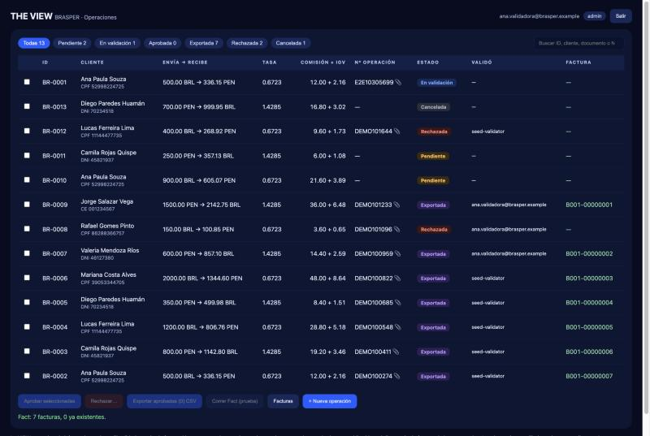
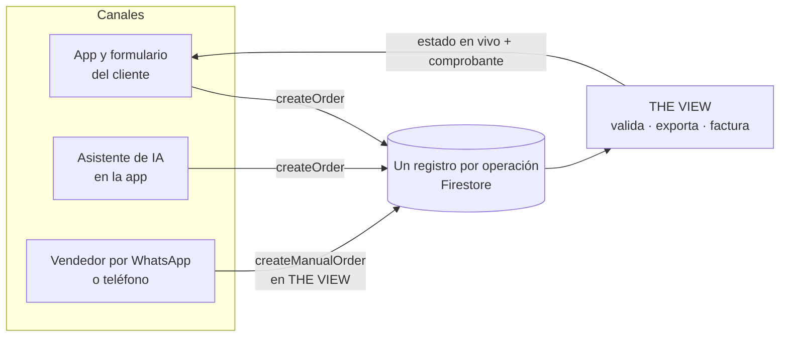
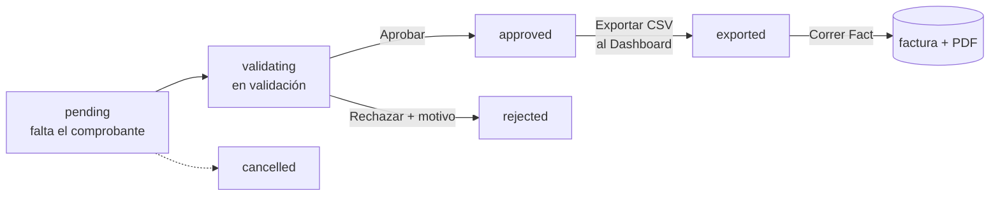
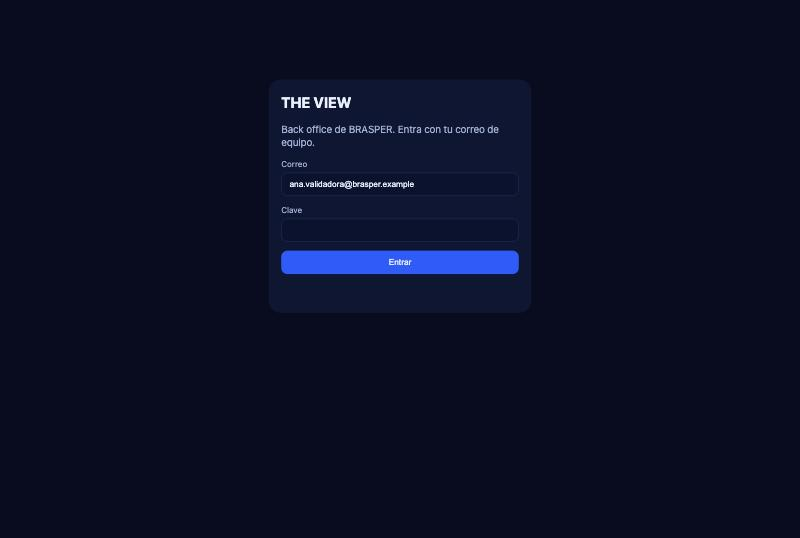
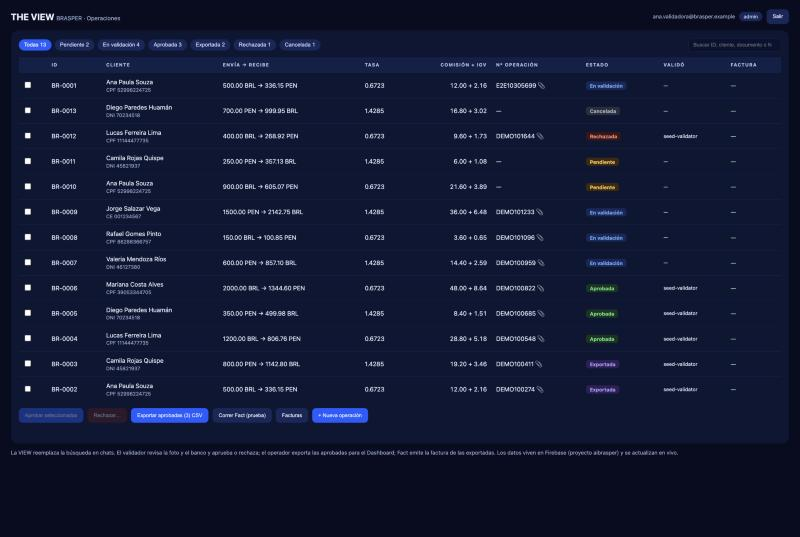
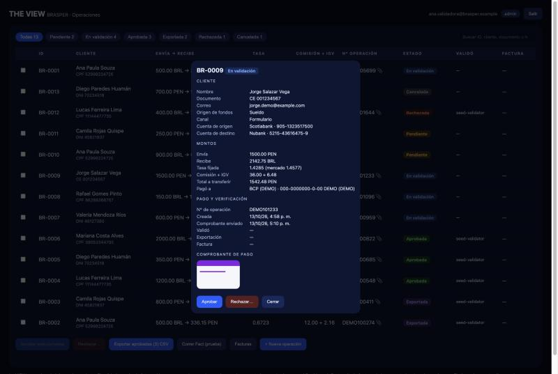
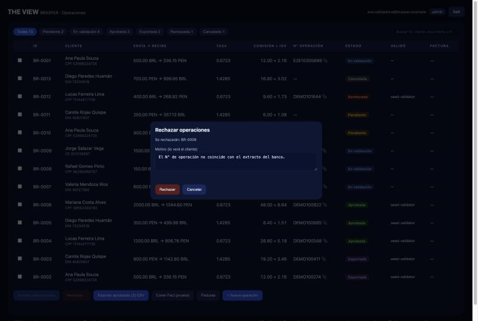
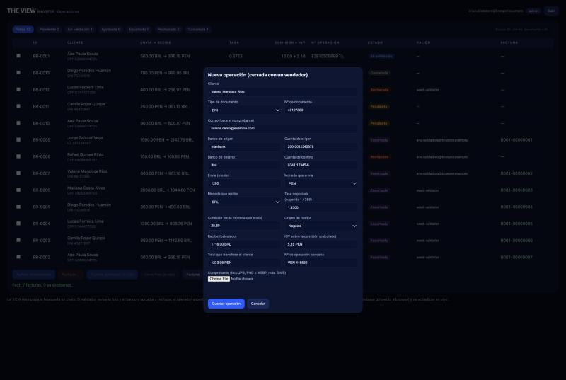

# THE VIEW: el back office que controla todas las órdenes de BRASPER

> Pantalla del equipo de **BRASPER** (cambio y envío de dinero Brasil ⇄ Perú, PIX ⇄ PEN) para validar pagos, exportar órdenes al Dashboard y emitir facturas. Es la otra mitad de la solución presentada en **IATHON Perú 2026**: la [app de clientes con asistente de IA](https://github.com/binnicordova/iathon-fintech) crea las órdenes; **THE VIEW** las controla.
>
> *English: the BRASPER back office. Every order, from every channel, lands in one live list where a person validates the payment, exports to the Dashboard and triggers billing. Firebase project `aibrasper`.*

<p align="center"></p>
<p align="center"><sub>Todas las operaciones en una sola lista, en vivo. Datos sintéticos de demostración (emulador local de Firebase).</sub></p>

**Equipo:** the VIEW (pantalla y flujo originales) · MVP de BRASPER. **Integración con Firebase y back office conectado:** [BinniCordova.com](https://binnicordova.com), Team 5.5, [IATHON 2026](https://lnkd.in/p/d5fZDx7k).

---

## 1. El negocio: BRASPER

BRASPER cambia dinero entre Brasil y Perú: el cliente envía reales por PIX y el destinatario recibe soles en un banco peruano (o al revés). Según el diagnóstico del equipo en el [plan del producto](https://binnicordova.github.io/iathon-fintech/) (estimaciones del equipo, no medidas):

| Hoy | |
|---|---|
| Equipo | 7 personas: 4 en ventas y 3 en facturación |
| Volumen | unas 60 operaciones al día, casi todas por chat |
| Comprobante | hasta 3 días después de confirmado el pago (meta: 20 minutos) |
| Atención | L–V 7–18, sáb 8–14, dom 12–14 (hora de Lima) |

**El problema del back office, hoy:** cada operación vive en un chat de WhatsApp. Un asesor mira una **captura del pago a ojo**, sin que quede registro de quién decidió, y **reescribe los mismos datos dos veces**: en el Dashboard y luego en la herramienta de facturación (KeyFácil en Perú, Omni en Brasil). No hay una estructura de datos definida y todo espera en una cola de chat. El plan lo marca en rojo: *"dB Schema!!!"*.

## 2. El objetivo

> Que **toda operación, venga por el canal que venga, quede en un solo registro** que una persona valida, que se exporta al Dashboard sin cambiarlo y que se factura sin reescribir nada.

THE VIEW es ese punto único de control. Para IATHON Perú 2026 es un MVP que funciona de verdad sobre el proyecto Firebase **`aibrasper`**: datos en Firestore, fotos privadas en Storage, reglas de negocio en Cloud Functions y acceso solo para usuarios con rol de equipo.

## 3. Por qué un back office que controla todos los canales (omnicanalidad)

BRASPER no deja WhatsApp: **suma canales**. Un cliente puede cotizar y pagar en la app, hacerlo conversando con el asistente de IA, o cerrar un monto grande con un vendedor. Los tres terminan en la misma orden:



**Por qué importa que haya un solo lugar:**

- **Consistencia entre canales.** Los clientes esperan que la empresa los trate igual sin importar dónde hablen con ella: Salesforce reporta que alrededor del 79% espera interacciones consistentes entre departamentos ([Salesforce](https://www.salesforce.com/resources/articles/customer-touch-points/)). Si cada canal guarda su propia versión de la operación, el cliente repite sus datos y el equipo no sabe cuál es la verdadera.
- **El cliente valioso usa varios canales.** El estudio de Harvard Business Review con unos 46.000 compradores de un minorista de EE. UU. ([Sopadjieva, Dholakia y Benjamin, 2017](https://hbr.org/2017/01/a-study-of-46000-shoppers-shows-that-omnichannel-retailing-works)) encontró que la mayoría usaba más de un canal y que quienes usaban varios gastaban más (según [un resumen secundario](https://www.bareinternational.com/bare-shares-study-shows-omnichannel-retailing-works/): 73% multicanal, cerca de 4% más en tienda y 10% más en línea por ocasión). Es comercio minorista, no finanzas; lo que se traslada es la forma del resultado. Sumar canales solo sirve si por detrás hay una sola vista del cliente y de la operación: esa vista es THE VIEW.
- **Retener cuesta menos que captar.** Adquirir un cliente nuevo puede costar entre 5 y 25 veces más que conservar uno, y Reichheld (Bain & Company) es citado por el efecto de la retención en las utilidades ([HBR, Gallo, 2014](https://hbr.org/2014/10/the-value-of-keeping-the-right-customers); cifras muy repetidas, tómalas como orden de magnitud). Con todas las operaciones en un registro, el equipo ve el historial y las cuentas guardadas de cada cliente y responde sin buscar en chats.

**Y es donde se controla el riesgo.** La ACFE estima que una organización típica pierde cerca del 5% de sus ingresos por fraude cada año ([ACFE, Occupational Fraud 2024](https://anchin.com/wp-content/uploads/2024/08/2024-ACFE-Occupational-Fraud-Report.pdf)) y que más de la mitad de los casos ocurren por falta de controles internos (32%) o por saltarse los existentes (19%) ([resumen del NJCPA](https://www.njcpa.org/learn/article/2024/09/20/preventing-and-detecting-occupational-fraud)). Validar un pago mirando una captura en un chat, sin registro, es justo ese vacío. THE VIEW pone el control que el plan pedía: **una persona valida cada pago y queda escrito quién, cuándo y por qué**, y las funciones se reparten por rol (el principio de "dos pares de ojos" o *maker-checker*: quien prepara no es quien aprueba; ver [Wikipedia](https://en.wikipedia.org/wiki/Maker-checker) y [Alvarez & Marsal sobre segregación de funciones](https://www.alvarezandmarsal.com/insights/segregation-duties-simple-idea-prevent-fraud)).

## 4. Cómo funciona



| Paso | Quién (rol) | Qué pasa | Función de Firebase |
|---|---|---|---|
| Ver todo en vivo, filtrar, buscar, abrir la foto y los datos | cualquier rol de equipo | lectura de Firestore y Storage | reglas |
| **Aprobar** o **rechazar con motivo** una operación En validación | `validator`, `admin` | queda escrito quién y cuándo | `reviewOrder` |
| **Exportar** las aprobadas (CSV para el Dashboard) | `operator`, `admin` | pasan a Exportada, con el lote registrado | `exportOrders` |
| **Correr Fact** (prueba): factura, XML y PDF | `billing`, `admin` | la factura aparece en la tabla | `runFact` |
| **Descargar** el PDF de la factura | cualquier rol de equipo | el cliente también lo ve en su app | `getReceipt` |
| **+ Nueva operación** cerrada por un vendedor, con la tasa negociada | `validator`, `operator`, `admin` | el servidor calcula IGV, monto a recibir y total | `createManualOrder` + `submitProof` |

El impuesto, el monto a recibir y el total **los calcula siempre el servidor**; el navegador solo muestra una vista previa. Fact corre en **modo prueba**: las facturas no tienen validez fiscal.

### Las pantallas

<table>
<tr>
<td width="50%"><br><sub><b>1. Acceso.</b> Solo entran usuarios de equipo con un rol. Sin rol no se lee nada.</sub></td>
<td width="50%"><br><sub><b>2. Todas las operaciones.</b> Estados, filtros y búsqueda, actualizados en vivo.</sub></td>
</tr>
<tr>
<td><br><sub><b>3. Detalle.</b> Todos los datos y la foto del pago, para compararlos con el banco antes de aprobar.</sub></td>
<td><br><sub><b>4. Rechazar con motivo.</b> El motivo queda registrado y el cliente lo ve.</sub></td>
</tr>
<tr>
<td><br><sub><b>5. Exportar y facturar.</b> Quién validó cada operación y su número de factura.</sub></td>
<td><br><sub><b>6. Nueva operación.</b> El vendedor registra lo que cerró por chat o teléfono; el total lo calcula el servidor.</sub></td>
</tr>
</table>

## 5. Cómo impacta a BRASPER

| | Hoy | Con THE VIEW |
|---|---|---|
| **Dónde está la verdad** | Chats de WhatsApp y hojas de cálculo | Un registro por operación, el mismo que ve el cliente en su app |
| **Validar un pago** | Captura revisada a ojo, sin rastro | Foto, N° de operación (se rechaza el duplicado) y datos juntos; queda quién aprobó o rechazó, cuándo y por qué |
| **Reescribir datos** | Dashboard y luego la herramienta de facturación | Se exporta un CSV del mismo registro y Fact factura desde él |
| **Cada canal** | Cada uno con su versión | App, asistente y vendedor alimentan la misma lista |
| **Facturar** | Hasta 3 días | Sale del registro apenas Fact acepta la venta (meta del equipo: 20 minutos) |
| **Trabajo del equipo** | Ventas y facturación reescriben | Ventas atiende lo que pide criterio (montos grandes, dudas, señales de fraude); facturación deja de reescribir *(es una expectativa, no una medición)* |

**Cómo sabremos que funcionó** (las métricas del plan; se miden en una herramienta de analítica aparte, no en esta app): tiempo entre pago confirmado y comprobante; porcentaje de operaciones creadas sin que un vendedor escriba nada; clientes que vuelven en 30 días y por qué canal; duplicados o N° de operación que no coinciden detectados antes de aprobar.

## 6. Seguridad y control de acceso

- **Roles** (custom claim `role` de Firebase Auth): `admin` (todo), `validator`, `operator`, `billing`. Un usuario sin rol no puede leer ni actuar.
- **Se aplica en el servidor.** Los botones se activan según tu rol, pero lo que decide son las reglas de Firestore/Storage y las Cloud Functions. Probado en emulador: un validador que llama a `exportOrders` o `runFact` recibe `role-not-allowed`; un usuario sin rol recibe `staff-only` y `PERMISSION_DENIED` al leer órdenes; un CPF inválido y una comisión mayor o igual al monto se rechazan.
- **Nadie escribe órdenes desde el navegador**: solo las Cloud Functions.
- **Sin secretos en el repositorio.** La configuración web de Firebase no se versiona: en Hosting la sirve la plataforma en `/__/firebase/init.json` y en local sale de `.env` (ignorado por git). Ver [Secretos](#secretos).

## 7. Cómo correrlo

```bash
npm install
cp .env.example .env     # completa FIREBASE_API_KEY, FIREBASE_MESSAGING_SENDER_ID y FIREBASE_APP_ID
npm start                # http://localhost:3000   (o doble clic en iniciar.bat en Windows)
```

Los valores salen de `firebase apps:sdkconfig WEB --project aibrasper`. **`.env` no se sube a git.**

### Crear usuarios de equipo

Necesita credenciales de Google en tu máquina (`gcloud auth application-default login`) y permiso en el proyecto:

```bash
npm run grant-staff -- tu@correo.com admin --password 'una-clave-segura'   # crea el usuario y le da el rol
npm run grant-staff -- otra@correo.com validator                         # a un usuario que ya existe
```

Después de cambiar un rol, cierra sesión y vuelve a entrar.

### Probar sin tocar producción (emuladores)

En el repo de la app de clientes ([`iathon_fintech`](https://github.com/binnicordova/iathon-fintech)): `bun run emulators`. Luego:

```bash
FIREBASE_AUTH_EMULATOR_HOST=127.0.0.1:9099 npm run grant-staff -- demo@brasper.test admin --password test-pass-123
# abre http://localhost:3000/?emulator   (aparece la etiqueta EMULADOR)
```

Las capturas de este README salen de ese emulador con datos sintéticos (`bun run seed:demo` en `iathon_fintech`).

### Firebase en este repo

- `.firebaserc`: proyecto `aibrasper`; el target de hosting `view` apunta al sitio `aibrasper-view`.
- `firebase.json`: hosting estático de `public/` con cabeceras de seguridad. El sitio por defecto de `aibrasper` es de la app de clientes, por eso THE VIEW usa el suyo. Para publicarla (una vez):
  ```bash
  firebase hosting:sites:create aibrasper-view --app <APP_ID de la app web> --project aibrasper   # --app enlaza la app web para que Hosting sirva /__/firebase/init.json
  npm run deploy
  ```
- El código del servidor (reglas de negocio) está en `iathon_fintech/functions`; aquí `server.js` solo sirve los archivos en local.

### Secretos

- Nada secreto se versiona: `.env`, `.env.*`, `serviceAccount*.json` y `*-adminsdk-*.json` están en `.gitignore`.
- La clave web de Firebase (`apiKey`) **no es una contraseña**, pero los escáneres de secretos la marcan y conviene restringirla en Google Cloud Console > APIs y servicios > Credenciales: por **referente HTTP** (`localhost:3000/*` y el dominio de THE VIEW) y a las APIs que usa (Identity Toolkit, Firestore, Cloud Functions, Cloud Storage).
- Lo que protege los datos son Firebase Auth, las reglas y los roles.
- Para crear usuarios se usan credenciales de Google de tu máquina; no hay cuentas de servicio en el repo. Si algún día se sube un secreto por error, rótalo primero y luego límpialo del historial.

## 8. Qué cambió respecto a la versión con SQLite

La versión anterior guardaba todo en SQLite local (`db.js`, `uploads/`) con datos de ejemplo. Ahora la fuente de verdad es Firestore, las fotos viven en Storage (privadas) y las reglas de negocio están en las Cloud Functions, así que la app de clientes y THE VIEW ven **las mismas** operaciones. Se quitaron `db.js`, `multer` y `node:sqlite`.

## 9. Límites del MVP (sin adornos)

- **Quien registra una operación manual puede aprobarla.** El MVP separa funciones por rol, pero no impide que el mismo usuario cree y apruebe; el siguiente paso es bloquear la auto-aprobación (*maker-checker* estricto) y usar roles distintos por persona en vez de `admin`.
- **Sin historial por evento:** se guarda quién aprobó o rechazó y cuándo, quién exportó (lote) y la factura, pero no una bitácora de todos los cambios.
- **WhatsApp no está automatizado:** un vendedor registra a mano lo que cierra por ahí con "+ Nueva operación".
- **Fact es simulado** (sin KeyFácil/Omni) y el PDF no se envía por correo: se descarga desde THE VIEW.
- **Sin pantalla de usuarios** (los roles se dan con `grant-staff`) **ni paginación** (se muestran las últimas 300 operaciones).
- El CSV sigue las columnas del plan; falta confirmar el formato exacto que importa el Dashboard.
- Probado en emuladores y desplegado en producción solo el backend; falta crear el primer usuario de equipo en producción.

## Referencias

Las marcadas *(secundaria)* son resúmenes de prensa o de terceros de un estudio que no pude abrir completo; conviene revisar la fuente original antes de citar una cifra.

- BRASPER: [plan del producto y análisis](https://binnicordova.github.io/iathon-fintech/) y [app de clientes](https://github.com/binnicordova/iathon-fintech).
- Salesforce. [How Are Customer Touch Points Changing?](https://www.salesforce.com/resources/articles/customer-touch-points/) (consistencia entre departamentos).
- Sopadjieva, E., Dholakia, U. y Benjamin, B. (2017). [A Study of 46,000 Shoppers Shows That Omnichannel Retailing Works](https://hbr.org/2017/01/a-study-of-46000-shoppers-shows-that-omnichannel-retailing-works). *Harvard Business Review.* Cifras vía [BARE International](https://www.bareinternational.com/bare-shares-study-shows-omnichannel-retailing-works/) *(secundaria)*.
- Gallo, A. (2014). [The Value of Keeping the Right Customers](https://hbr.org/2014/10/the-value-of-keeping-the-right-customers). *Harvard Business Review.*
- ACFE (2024). [Occupational Fraud 2024: A Report to the Nations](https://anchin.com/wp-content/uploads/2024/08/2024-ACFE-Occupational-Fraud-Report.pdf) y [resumen del NJCPA](https://www.njcpa.org/learn/article/2024/09/20/preventing-and-detecting-occupational-fraud) *(secundaria)*.
- Wikipedia. [Maker-checker](https://en.wikipedia.org/wiki/Maker-checker) y Alvarez & Marsal. [Segregation of duties: a simple idea to prevent fraud](https://www.alvarezandmarsal.com/insights/segregation-duties-simple-idea-prevent-fraud) *(la ACFE no cuantifica la segregación de funciones; esto es análisis de terceros)*.
